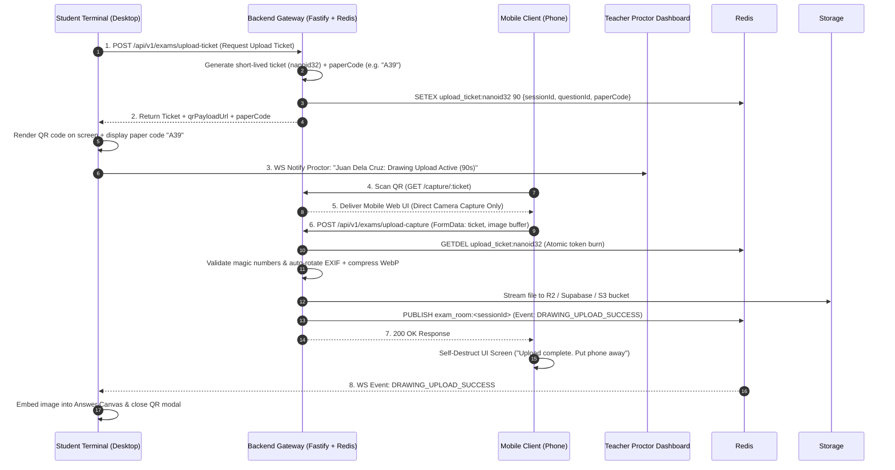

# Ephemeral QR Code Mobile Upload Gateway — Engineering & Implementation Plan

This document outlines the end-to-end design, communication flow, security threat model, and production-ready implementation details for capturing physical paper drawings during a sandboxed exam session via an ephemeral QR code mobile gateway.

---

## 1. Executive Workflow & Lifecycle

The architecture coordinates three synchronized actors: the **Student Exam Terminal (Desktop)**, the **Mobile Capture Client (Smartphone)**, and the **Teacher Proctoring Dashboard**.



---

## 2. Security Threat Model & Countermeasures

| Threat Vector | Attack Scenario | Architectural Countermeasure |
| :--- | :--- | :--- |
| **Pre-Drawn Answer Swap** | Student uploads a diagram drafted prior to the exam or sent by an external accomplice. | **Dynamic Paper Watermark:** The desktop displays a random 3-digit challenge code (e.g., `A39`). The student must handwrite this code on their paper; teachers verify it in the side-by-side grading rubric. |
| **Photo Gallery Injection** | Student opens their phone to pick an image saved from Google, ChatGPT, or Discord. | **Forced Camera Invocation:** Mobile HTML enforces `<input type="file" capture="environment" accept="image/*">`. Mobile browsers bypass the gallery picker and directly launch the native rear camera. |
| **Token Hijacking / Link Sharing** | Student sends the QR URL to an outside collaborator to upload answers remotely. | **Single-Use + Rapid TTL:** Tickets expire in **90 seconds** in Redis. Token burn is executed atomically on lookup via Redis `GETDEL` (or Lua fallback). |
| **Browsing & Chatting on Phone** | Student leaves the upload page on mobile to query answers online. | **Desktop Face & Time Watchdog:** The desktop camera remains active. If the upload window exceeds 90s, the gateway revokes the ticket, flags an anomaly to the proctor console, and locks the desktop exam. |

---

## 3. Data Flow & Communication Contracts

### A. Initialization Request (Desktop ➔ API)

* **Endpoint:** `POST /api/v1/exams/upload-ticket`
* **Headers:** `Authorization: Bearer <STUDENT_DESKTOP_JWT>`
* **Payload:**
```json
{
  "examSessionId": "550e8400-e29b-41d4-a716-446655440000",
  "questionId": "7c9e6679-7425-40de-944b-e07fc1f90ae7"
}
```

* **Gateway Actions:**
  1. Generates `ticket` via `nanoid(32)`.
  2. Generates short paper challenge code `paperCode` (e.g., `"A39"`).
  3. Writes session state to Redis with a 90-second TTL:
     ```bash
     SETEX upload_ticket:nanoid32 90 '{"examSessionId":"...","questionId":"...","paperCode":"A39","status":"PENDING"}'
     ```

* **Response (200 OK):**
```json
{
  "qrPayloadUrl": "https://exam.domain.com/capture/nanoid32",
  "paperCode": "A39",
  "expiresInSeconds": 90
}
```

---

### B. Image Ingestion (Mobile Client ➔ API)

* **Endpoint:** `POST /api/v1/exams/upload-capture`
* **Content-Type:** `multipart/form-data`
* **Form Fields (Strict Order):**
  1. `ticket`: `"nanoid32"` (String - Must precede file binary for streaming parser)
  2. `image`: Raw Binary Buffer (JPEG, PNG, or WebP)

* **Backend Validation Pipeline:**
  1. **Atomic Retrieval & Burn:** Execute Redis `GETDEL upload_ticket:nanoid32`. If null, return `410 Gone` (expired or already consumed).
  2. **Magic Number Inspection:** Inspect buffer byte headers to verify image magic bytes (`0xFF 0xD8` for JPEG, `0x89 0x50` for PNG, `RIFF` for WebP). Reject executables or disguised PDFs.
  3. **Auto-Orientation & Optimization:** Pass buffer to `sharp()`, auto-orient via `.rotate()`, resize (max-width 1600px, without enlargement), and convert to `.webp` at 80% quality.
  4. **Storage Stream:** Push optimized buffer to S3 / Cloudflare R2 / Supabase Storage.
  5. **Pub/Sub Event:** Emit real-time WebSocket notification to the student's desktop room:
     ```bash
     PUBLISH exam_room:<examSessionId> '{"event":"DRAWING_UPLOAD_SUCCESS","payload":{"questionId":"...","imageUrl":"..."}}'
     ```

---

## 4. Implementation Blueprint

### Step 1: Server Gateway Handler (Fastify / Node.js)

```typescript
// src/routes/uploadGateway.ts
import { FastifyInstance, FastifyRequest, FastifyReply } from "fastify";
import { customAlphabet } from "nanoid";
import { redis } from "../lib/redis";
import { uploadToR2 } from "../lib/storage";
import sharp from "sharp";

const nanoid = customAlphabet("1234567890abcdefghijklmnopqrstuvwxyzABCDEFGHIJKLMNOPQRSTUVWXYZ", 32);
const codeGen = customAlphabet("ABCDEFGHJKLMNPQRSTUVWXYZ23456789", 3);

// Magic byte verification helper
function isValidImageHeader(buffer: Buffer): boolean {
  if (buffer.length < 4) return false;
  const isJpeg = buffer[0] === 0xff && buffer[1] === 0xd8 && buffer[2] === 0xff;
  const isPng = buffer[0] === 0x89 && buffer[1] === 0x50 && buffer[2] === 0x4e && buffer[3] === 0x47;
  const isWebp = buffer.toString("utf8", 8, 12) === "WEBP";
  return isJpeg || isPng || isWebp;
}

export async function uploadGatewayRoutes(app: FastifyInstance) {
  // 1. Desktop requests an upload ticket
  app.post("/api/v1/exams/upload-ticket", async (req: FastifyRequest, reply: FastifyReply) => {
    const { examSessionId, questionId } = req.body as { examSessionId: string; questionId: string };

    const ticket = nanoid();
    const paperCode = codeGen();

    const ticketData = {
      examSessionId,
      questionId,
      paperCode,
      createdAt: Date.now()
    };

    // 90-second hard TTL
    await redis.set(`upload_ticket:${ticket}`, JSON.stringify(ticketData), "EX", 90);

    return reply.send({
      qrPayloadUrl: `${process.env.APP_BASE_URL}/capture/${ticket}`,
      paperCode,
      expiresInSeconds: 90
    });
  });

  // 2. Mobile uploads captured drawing
  app.post("/api/v1/exams/upload-capture", async (req: FastifyRequest, reply: FastifyReply) => {
    const data = await req.file();
    if (!data) {
      return reply.status(400).send({ error: "No image file uploaded." });
    }

    const ticket = (data.fields.ticket as any)?.value;
    if (!ticket) {
      return reply.status(400).send({ error: "Missing upload ticket parameter." });
    }

    // Atomic lookup & burn using GETDEL (Redis 6.2+)
    const rawTicket = await redis.getdel(`upload_ticket:${ticket}`);
    if (!rawTicket) {
      return reply.status(410).send({ error: "Upload session expired or already completed." });
    }

    const { examSessionId, questionId } = JSON.parse(rawTicket);
    const buffer = await data.toBuffer();

    // Verify buffer magic bytes
    if (!isValidImageHeader(buffer)) {
      return reply.status(415).send({ error: "Invalid file type. Only JPEG, PNG, and WebP images are permitted." });
    }

    // Image optimization via Sharp (with EXIF auto-rotation)
    const optimizedWebP = await sharp(buffer)
      .rotate() // Auto-rotate portrait/landscape based on EXIF
      .resize({ width: 1600, withoutEnlargement: true })
      .webp({ quality: 80 })
      .toBuffer();

    const destinationKey = `answers/${examSessionId}/${questionId}_${Date.now()}.webp`;
    const publicUrl = await uploadToR2(destinationKey, optimizedWebP, "image/webp");

    // Notify Desktop Client via WebSocket / PubSub
    await redis.publish(
      `exam_room:${examSessionId}`,
      JSON.stringify({
        event: "DRAWING_UPLOAD_SUCCESS",
        payload: { questionId, imageUrl: publicUrl }
      })
    );

    return reply.send({ success: true, message: "Drawing synced successfully." });
  });
}
```

---

### Step 2: Zero-Install Mobile Capture Client

```html
<!-- public/capture.html -->
<!DOCTYPE html>
<html lang="en">
<head>
  <meta charset="UTF-8">
  <meta name="viewport" content="width=device-width, initial-scale=1.0, maximum-scale=1.0, user-scalable=no">
  <title>Exam Answer Capture</title>
  <style>
    body { font-family: system-ui, -apple-system, sans-serif; margin: 0; padding: 24px; background: #0f172a; color: #f8fafc; text-align: center; }
    .card { background: #1e293b; border-radius: 16px; padding: 24px; border: 1px solid #334155; box-shadow: 0 10px 25px -5px rgba(0,0,0,0.3); }
    .btn { display: inline-block; width: 100%; padding: 18px 0; background: #2563eb; color: #fff; font-size: 18px; font-weight: 700; border-radius: 10px; border: none; cursor: pointer; transition: background 0.2s; }
    .btn:active { background: #1d4ed8; }
    #cameraInput { display: none; }
    .status { margin-top: 16px; font-size: 14px; color: #94a3b8; line-height: 1.5; }
    .success { display: none; color: #4ade80; }
  </style>
</head>
<body>
  <div class="card" id="mainCard">
    <h2 style="margin-top:0;">Capture Paper Answer</h2>
    <p class="status">Ensure the handwritten 3-digit security code is visible on your paper before snapping the photo.</p>
    
    <label for="cameraInput" class="btn" style="margin-top:16px;">Open Camera</label>
    <!-- capture="environment" invokes rear camera directly, blocking photo gallery selection -->
    <input type="file" id="cameraInput" accept="image/*" capture="environment">

    <p id="uploadingText" class="status" style="display:none; color:#38bdf8;">Uploading drawing to your exam screen...</p>
  </div>

  <div class="card success" id="successCard">
    <h2 style="margin-top:0; color:#4ade80;">Drawing Synced!</h2>
    <p class="status">Your paper has appeared on your desktop screen. Put your phone away immediately and continue your exam.</p>
  </div>

  <script>
    const ticket = window.location.pathname.split("/").pop();
    const input = document.getElementById("cameraInput");

    input.addEventListener("change", async (e) => {
      const file = e.target.files[0];
      if (!file) return;

      document.getElementById("uploadingText").style.display = "block";

      const formData = new FormData();
      formData.append("ticket", ticket); // Appended FIRST for stream parser
      formData.append("image", file);     // Binary payload LAST

      try {
        const res = await fetch("/api/v1/exams/upload-capture", {
          method: "POST",
          body: formData
        });

        if (res.ok) {
          document.getElementById("mainCard").style.display = "none";
          document.getElementById("successCard").style.display = "block";
        } else {
          alert("Ticket expired or invalid. Please re-open the QR code on your computer.");
        }
      } catch (err) {
        alert("Upload failed. Check your internet connection.");
      }
    });
  </script>
</body>
</html>
```

---

### Step 3: Desktop Student Terminal Component (React + Canvas Sync)

```tsx
// components/QuestionDrawingUploader.tsx
import React, { useState, useEffect } from "react";
import QRCode from "react-qr-code";

interface Props {
  examSessionId: string;
  questionId: string;
  socket: WebSocket;
  onImageSynced: (imageUrl: string) => void;
}

export const QuestionDrawingUploader: React.FC<Props> = ({
  examSessionId,
  questionId,
  socket,
  onImageSynced
}) => {
  const [modalOpen, setModalOpen] = useState(false);
  const [qrUrl, setQrUrl] = useState<string | null>(null);
  const [paperCode, setPaperCode] = useState<string | null>(null);
  const [secondsRemaining, setSecondsRemaining] = useState(90);

  const initUploadTicket = async () => {
    const res = await fetch("/api/v1/exams/upload-ticket", {
      method: "POST",
      headers: { "Content-Type": "application/json" },
      body: JSON.stringify({ examSessionId, questionId })
    });
    const data = await res.json();
    setQrUrl(data.qrPayloadUrl);
    setPaperCode(data.paperCode);
    setSecondsRemaining(data.expiresInSeconds);
    setModalOpen(true);
  };

  // Countdown timer for upload window
  useEffect(() => {
    if (!modalOpen || secondsRemaining <= 0) return;
    const interval = setInterval(() => {
      setSecondsRemaining((prev) => {
        if (prev <= 1) {
          setModalOpen(false); // Close modal on expiry
          return 0;
        }
        return prev - 1;
      });
    }, 1000);
    return () => clearInterval(interval);
  }, [modalOpen, secondsRemaining]);

  // Listen to WebSocket for successful mobile sync
  useEffect(() => {
    const handleMessage = (event: MessageEvent) => {
      const data = JSON.parse(event.data);
      if (data.event === "DRAWING_UPLOAD_SUCCESS" && data.payload.questionId === questionId) {
        onImageSynced(data.payload.imageUrl);
        setModalOpen(false);
      }
    };

    socket.addEventListener("message", handleMessage);
    return () => socket.removeEventListener("message", handleMessage);
  }, [socket, questionId, onImageSynced]);

  return (
    <div className="drawing-container">
      <button 
        type="button"
        onClick={initUploadTicket} 
        className="px-4 py-2 bg-blue-600 text-white rounded font-medium hover:bg-blue-700 transition"
      >
        Upload Paper Drawing via Phone QR
      </button>

      {modalOpen && qrUrl && (
        <div className="fixed inset-0 bg-black/70 flex items-center justify-center z-50">
          <div className="bg-slate-900 border border-slate-700 p-6 rounded-xl text-center max-w-sm">
            <h3 className="text-lg font-bold text-white mb-2">Scan with Phone Camera</h3>
            
            <div className="bg-white p-3 rounded-lg inline-block my-3">
              <QRCode size={180} value={qrUrl} />
            </div>

            <div className="bg-amber-950/60 border border-amber-500/40 p-3 rounded my-2">
              <span className="text-xs text-amber-300 block font-semibold">MANDATORY PAPER CODE</span>
              <span className="text-2xl font-black text-amber-400 tracking-widest">{paperCode}</span>
              <p className="text-[11px] text-amber-200/80 mt-1">Write this code on top of your paper drawing.</p>
            </div>

            <p className="text-xs text-slate-400">
              Window closes in <strong className="text-white">{secondsRemaining}s</strong>
            </p>
          </div>
        </div>
      )}
    </div>
  );
};
```

---

## 5. Teacher Proctoring & Grading Audit

* **Live Feed Status Notifications:** When the QR code is generated, the teacher's proctor dashboard displays an active status pill:  
  `[Juan Dela Cruz]: Drawing Upload Active (84s remaining)`
* **Side-by-Side Verification Screen:**
  * **Left Pane:** Prompt instructions, sample diagrams, and scoring rubrics.
  * **Right Pane:** High-resolution uploaded student paper drawing with zoom, pan, and 90° rotation controls.
  * **Header Watermark Badge:** Expected challenge code (e.g., `#A39`) alongside submission timestamp so proctors can verify paper authenticity in under 3 seconds.

---

## 6. Advanced & Extended Security Features

### A. Desktop Webcam Proctoring Watchdog (Presence Monitoring)
While the 90-second mobile upload modal is active on the desktop terminal, the desktop webcam feed remains continuously engaged to perform local face presence tracking:
* **Absence Detection:** If the student leaves the computer desk during the 90-second upload window, a `PROCTOR_ANOMALY` event is automatically dispatched to the teacher console.
* **Expiration Lockout:** If the 90-second timer expires without an upload, the gateway revokes the active ticket and locks the student's exam interface pending proctor unlock.

### B. Dual-Storage Provider Support (Cloudflare R2 & Supabase Storage)
The storage layer provides fallback capabilities between Cloudflare R2 and Supabase Storage:
```typescript
// src/lib/storage.ts
import { createClient } from "@supabase/supabase-js";
import { S3Client, PutObjectCommand } from "@aws-sdk/client-s3";

const s3Client = new S3Client({
  endpoint: process.env.R2_ENDPOINT,
  credentials: {
    accessKeyId: process.env.R2_ACCESS_KEY_ID!,
    secretAccessKey: process.env.R2_SECRET_ACCESS_KEY!,
  },
  region: "auto",
});

const supabase = createClient(
  process.env.SUPABASE_URL!,
  process.env.SUPABASE_SERVICE_ROLE_KEY!
);

export async function uploadToStorage(
  destinationKey: string,
  buffer: Buffer,
  contentType: string
): Promise<string> {
  try {
    // Primary: Cloudflare R2 / S3 Storage
    await s3Client.send(
      new PutObjectCommand({
        Bucket: process.env.R2_BUCKET_NAME,
        Key: destinationKey,
        Body: buffer,
        ContentType: contentType,
      })
    );
    return `${process.env.R2_PUBLIC_DOMAIN}/${destinationKey}`;
  } catch (err) {
    console.warn("R2 upload failed, falling back to Supabase Storage...", err);
    // Fallback: Supabase Storage
    const { data, error } = await supabase.storage
      .from("exam-drawings")
      .upload(destinationKey, buffer, { contentType, upsert: true });

    if (error) throw error;
    const { data: publicData } = supabase.storage
      .from("exam-drawings")
      .getPublicUrl(destinationKey);

    return publicData.publicUrl;
  }
}
```

### C. Automated Anomaly Event Broadcasting
```typescript
// Event payload sent to proctor websocket channel when upload expires or face is lost
interface ProctorAnomalyPayload {
  event: "UPLOAD_ANOMALY_DETECTED";
  examSessionId: string;
  studentId: string;
  reason: "EXPIRED_TTL" | "DESKTOP_FACE_ABSENT" | "MULTIPLE_SUBMISSIONS";
  timestamp: number;
}
```
